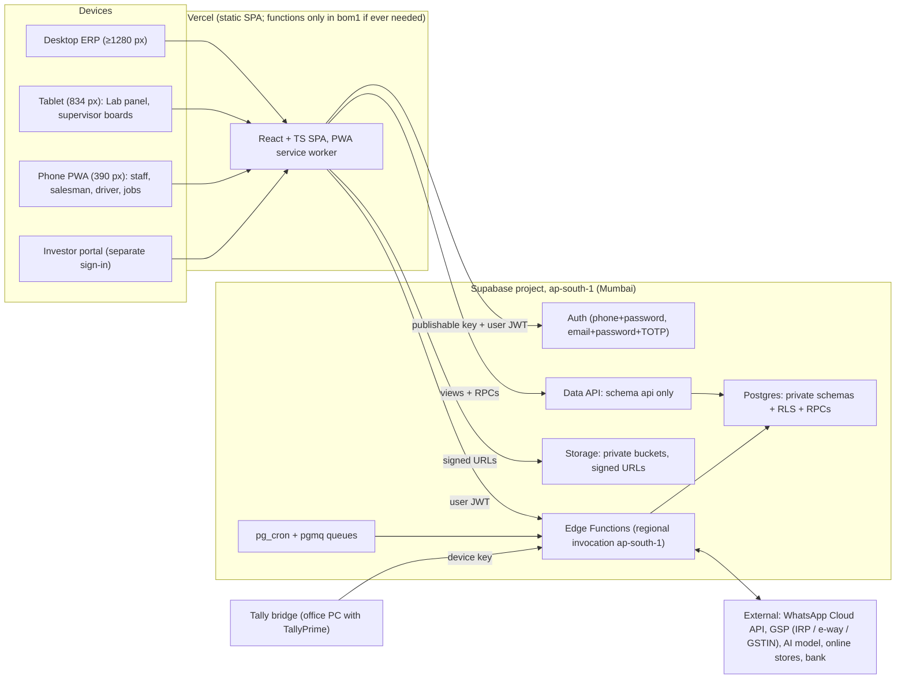
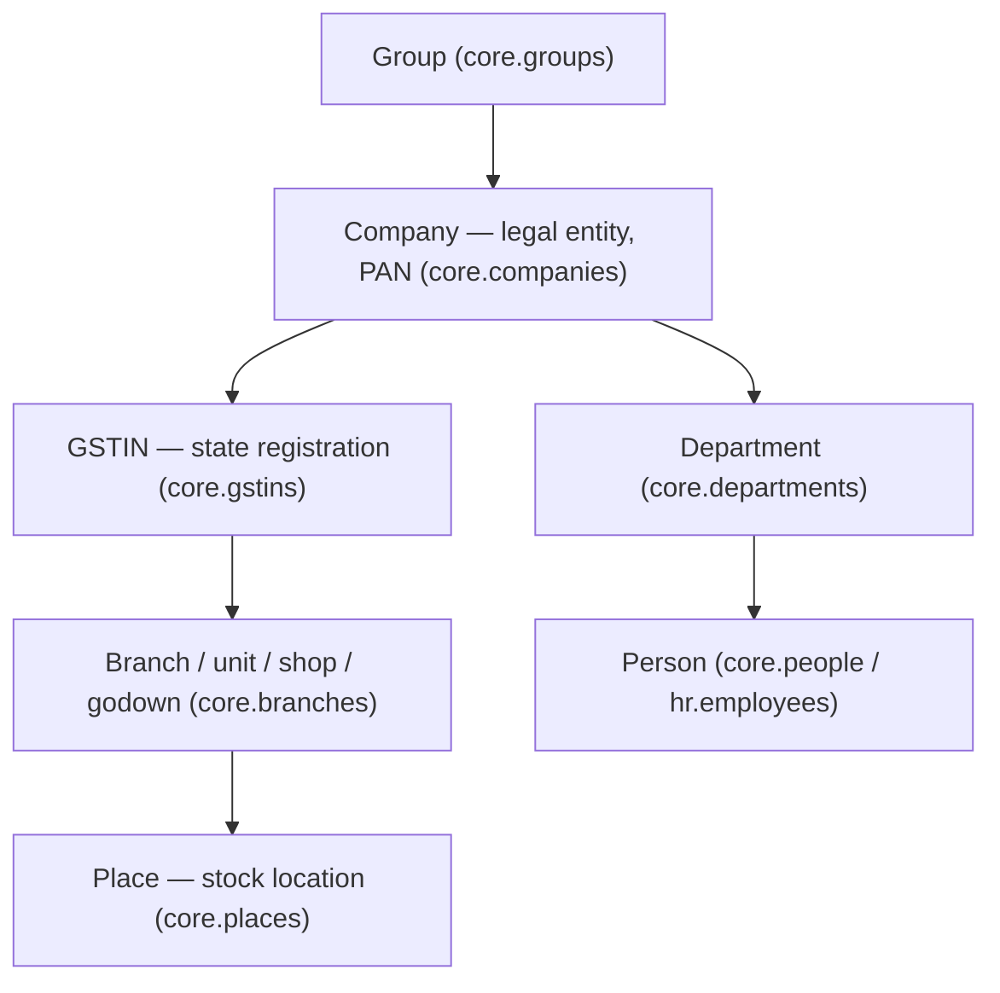
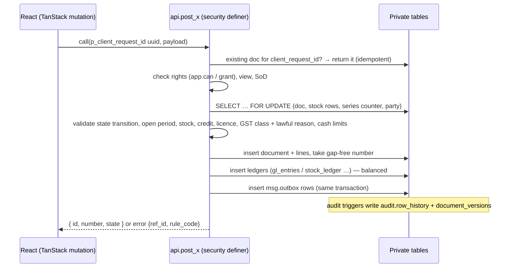

# Southfield Group ERP — Architecture

Status: **Phase 0 draft**, awaiting owner review. Source of truth: `docs/prompts/SOUTHFIELD_ERP_PROMPT.md` (Parts 1–3) and `AGENTS.md`. The build specification (`docs/spec/SOUTHFIELD_ERP_SPEC.md`) is **missing**; see Open questions in `IMPLEMENTATION_STATUS.md`.

---

## 1. System overview



Principles (non-negotiable, from `AGENTS.md`):

- **Business logic lives only in Postgres functions (RPCs).** The browser previews by calling the same function; it never decides a posted amount, tax, stock or pay.
- **RLS on every table**, and rights re-checked inside every RPC.
- **Append-only ledgers** (stock, GL, material consumption, asset events, audit history). Corrections are reversal + new document, both linked.
- **Data stays in India**: Supabase `ap-south-1`, Edge Functions regionally invoked in `ap-south-1`, Vercel functions (if any) in `bom1`, backups only to Indian locations.

## 2. Frontend

| Concern | Decision (Phase 0) |
|---|---|
| Build | Vite + React 19 + TypeScript `strict`, pnpm |
| Routing | React Router; route table in `src/app/routes.tsx` (paths from `PAGE_INVENTORY.md`) |
| Server state | TanStack Query; all reads via `api` views, all writes via `api` RPCs |
| Forms | React Hook Form + Zod; Zod schemas in `src/shared/` (reused by Edge Functions) |
| Styling | CSS custom properties from `docs/design/tokens.css`; IBM Plex Sans / Mono; Noto Sans Malayalam / Devanagari fallbacks. No UI kit theme. |
| Primitives | Radix only for Dialog (`ConfirmDialog`); everything else hand-built in `src/ui/` |
| i18n | i18next, locales `en`, `ml`, `hi`, `bho` in `src/i18n/locales/*.json`; non-English files carry a `needs-native-review` flag |
| Phone / tablet | Same app as a PWA (`vite-plugin-pwa`); drafts in IndexedDB via `idb-keyval`; `OfflineBadge` |
| Tests | Vitest (units), Playwright + `@axe-core/playwright` (e2e + a11y), pgTAP via `supabase test db` |

### Source layout

```
src/
  app/        routes.tsx, nav.ts (sidebar order §UX-4.1 + right keys), flows.ts (from WORKFLOWS.md)
  ui/         Card, KpiTile, DataTable, Amount, StatusChip, TaxClassChip, Button, Field, Tabs,
              ConfirmDialog, PhoneHeader, BottomNav, OfflineBadge, ComingInPhase, ErrorRef …
  ui/shell/   DesktopShell, Sidebar, Topbar, FlowStrip, PhoneShell
  features/<module>/   one folder per module (auth, home, sales, purchase, production, inventory,
                       logistics, exports, hr, accounts, admin, staff, field, driver, lab, me, investor, dev)
  shared/     supabase client, en-IN formatters (amount, DD-MM-YYYY, FY), Zod schemas, database.types.ts
  i18n/       i18next setup + locales
supabase/
  migrations/ plain SQL, one purpose per file, header comment
  tests/      pgTAP
  functions/  Edge Functions (Deno)
e2e/          Playwright specs (assert DB state) + axe
```

`/dev/ui` (component gallery) is mounted only when `import.meta.env.DEV`.

## 3. Organisation hierarchy (§5)



- Place kinds: stores, quarantine, WIP, FG hold, FG released, damage, transit, van, agent consignment.
- Every business row carries `company_id`; `gstin_id` and `place_id` wherever tax or stock depends on them.
- Per company: financial years and periods, document series, chart of accounts, GST settings (e-invoice per GSTIN, e-way thresholds per state), currency settings.
- GSTINs, branches and units are **data entered by Admin** on the Companies / Branches and GSTINs / Units screens. Never hard-coded (test fixtures use synthetic values).
- Branch moves: same GSTIN → **delivery challan**; different GSTIN → **tax invoice with IGST** (+ e-way bill when value requires); between the two companies → always sale and purchase.

## 4. Database schemas

All business tables live in private schemas. The Data API exposes **only `api`**.

| Schema | Holds | First phase |
|---|---|---|
| `app` | RLS/RPC helper functions (`app.can`, `app.current_view`, `app.has_grant`, `app.take_doc_number` …). Not exposed. | 1 |
| `core` | groups, companies, GSTINs, branches, places, departments, FY/periods, users, roles, rights, scopes, special grants, settings, doc series, state transitions, document links, forms/fields, licences, assets | 1 |
| `master` | HSN + effective-dated rates, UoM, product groups/families/products, MRP history, labels, parties (group-level) + company links, KYC docs, bank accounts, credit terms, price lists, aliases | 2 |
| `inv` | lots, `stock_ledger` (append-only), balance views, transfers, reservations, counts, reorder levels | 4 |
| `prod` | formulas, batches, weighings, `material_consumption` (append-only), labs, instruments, packs/free items, moulds, machines, injection shifts, quality, assembly, pad printing, maintenance, job work | 5 |
| `sales` | quotations, orders, invoices, challans, credit notes, receipts, credit control, complaints, agents, shops, online, exports, dispatch/trips/POD | 3 |
| `purch` | requests, RFQs, POs, goods receipts, supplier bills, payments, bill captures, price history | 3 |
| `acct` | chart of accounts, posting rules, vouchers, `gl_entries` (append-only), bill-wise allocations, bank, TDS, GST workings, period close, partners/directors | 2 |
| `hr` | employees (one group list), masked KYC, assignments, rotation, duties, attendance, requests, allowances, cash given, payroll, payslips | 3 |
| `field` | beats, salesman–customer assignment, visits, GPS points (90-day retention), queries, cash handovers, day close | 6 |
| `ops` | `error_log`, Bug fixer items, imports, `source_keys`, Tally mapping, bridge devices, backup/restore runs, vehicles, integration request logs | 1 |
| `msg` | channels, templates, contacts + consent, outbox, inbound, events (§WA-2) | 3 |
| `help` | help pages, `chunks` (pgvector), conversations, messages (§HELP-5/6) | 3 |
| `audit` | `row_history`, `user_log`, `document_versions` (transaction log) — append-only | 1 |
| `api` | `security_invoker` views and RPC functions — the only exposed surface | 0/1 |

Table-level contracts are written per phase in `docs/DATABASE_SCHEMA.md` **before** each module is built (§28).

### Types and conventions

- Money `numeric(18,2)`; quantity `numeric(18,3)` (formula % `numeric(18,4)`); rates `numeric(9,4)`. No float/real.
- Business date in IST (`Asia/Kolkata`) + UTC `timestamptz`. FY April–March.
- Gap-free numbering per company + GSTIN + doc type + FY, taken at posting under a row lock; GST invoice numbers ≤ 16 chars, unique per FY.
- Every document type has a state machine in `core.state_transitions`, checked inside the RPC; the UI process diagrams read the same table.
- Hand-offs are document links (`core.document_links`: source → target), never copied loose data.

## 5. Auth, rights and views (§6, §UX-5)

### Sign-in

| Who | Method |
|---|---|
| Staff (all non-finance roles) | WhatsApp number (E.164) + password via Supabase phone auth |
| Admin / Owner, finance roles, CA | Email + password + **TOTP MFA** (AAL2 required by RLS for their rights) |
| Partners / investors | Separate portal sign-in (`/investor/sign-in`), analytics only |

- Public sign-up is **off**. Accounts are created only by Admin through the `admin-users` Edge Function (holds the secret key; checks the caller's `users.manage` right).
- Lock-out after repeated failures; short sessions on shared devices.

### Rights model

```
role → rights (module.action)          core.roles, core.rights, core.role_rights
user → roles                            core.user_roles
user → company / branch / place scope   core.user_scopes
approval limits (amounts)               core.approval_limits
time-limited grants                     core.special_grants (+ never-grantable list enforced in SQL)
```

RLS policies call `app.can(company_id, 'module.action')` (`stable`, `security definer`, `set search_path = ''`, uses `(select auth.uid())`). Every filtered column is indexed.

### Views (the top-bar chip)

| Chip | Who | Data |
|---|---|---|
| All transactions | Admin, Owner | Everything, bills without GST marked |
| All transactions · read-only | CA / Auditor (time window) | Everything; no writes; banner "Read-only until <date>" |
| GST transactions | Everyone else incl. Office admin | GST-class documents only |

The UI never filters bills without GST — RLS decides which rows arrive; totals, counts, paging and exports are server-side.

**Phase 0 interim:** the view chip is derived from the user's server-set `app_metadata.role` in the Supabase JWT (the user cannot edit `app_metadata`). Unknown/missing role → GST view. **Phase 1** replaces this with `api.me()` reading `core.user_roles` + rights + view + active grants.

### Segregation of duties (enforced in RPCs)

Batch maker/weigher ≠ QC releaser · picker ≠ transfer closer · salesperson ≠ approver of own credit limit · preparer ≠ approver of own payment · nobody approves their own request.

## 6. RPC posting pattern (§23)



- `security definer`, `set search_path = ''`, one transaction, `client_request_id uuid` unique per doc type.
- Errors carry a `rule_code`; the UI logs them to `ops.error_log` and shows an `ErrorRef` (`ERR-…`) with "Ask Help about this".
- Ledgers grant no insert/update/delete to `authenticated`; triggers reject update/delete.

## 7. Edge Functions (all in `ap-south-1`, regional invocation)

| Function | Purpose | Phase |
|---|---|---|
| `admin-users` | Admin creates/disables accounts (signups off); sets `app_metadata` | 1 |
| `gstin-verify` | GSTIN check via GSP; monthly recheck | 2 |
| `tally-import` | Receives Tally XML/Excel and bridge uploads (device key); stages rows for import RPCs | 2 |
| `pdf-render` | Server PDFs from the `DocumentPreview` layout → private `documents` bucket | 3 |
| `whatsapp-sender` | Sends `msg.outbox`, re-checks §WA-4 rules at send time | 3 |
| `whatsapp-webhook` | Verifies `X-Hub-Signature-256`, dedupes, updates status, stores inbound | 3 |
| `help-agent` | Help assistant; user JWT; read-only tool allow-list; redaction | 3 |
| `bank-statement-import` | Parses statements; password typed each time, never stored | 3 |
| `bill-photo-reader` | Reads a supplier bill photo into a draft | 4 |
| `store-webhooks` | Shopify / marketplaces order intake (signature, dedupe) | 6/8 |
| `gps-intake` | On-duty GPS points (90-day retention) | 6/8 |
| `einvoice` / `ewaybill` | IRP IRN + QR, e-way bill via GSP | 8 |

Edge Functions call external systems; they never duplicate posting logic. Background work: `pg_cron` + `pgmq` (retries, reminders, licence expiry, nightly checks, ledger control checks).

## 8. Storage

Private buckets only: `kyc` (HR + Admin), `bills`, `documents`, `licences`, `lab`, `imports`. Policies by company and right. Short-expiry signed URLs. Public links are never sent on WhatsApp.

## 9. Environments and data residency

| Environment | Supabase | Vercel | Notes |
|---|---|---|---|
| Local | `supabase start` | `pnpm dev` | Synthetic data only |
| Dev / Preview | **The one existing project** (`fxwoabbwzcifxzqsmrie`), treated as DEV | Preview deployments, Deployment Protection on | WhatsApp test-number allow-list only |
| Prod | **Not yet created** — must be a separate project in `ap-south-1` | Production from `main` | Migrations only via GitHub environment with owner approval |

- The browser receives only `VITE_SUPABASE_URL` and `VITE_SUPABASE_PUBLISHABLE_KEY`.
- The secret/service-role key lives only in Edge Function and CI secrets.
- Region of the existing project is **not yet verified** as `ap-south-1` (open question).
- Backups: Supabase daily + PITR (Mumbai); nightly encrypted `pg_dump` to a second Indian location from an India-hosted runner (never GitHub-hosted).

## 10. Security headers (Vercel)

`vercel.json`: SPA rewrite to `index.html`; CSP (self + Supabase URL for `connect-src`), HSTS, `frame-ancestors 'none'` / `X-Frame-Options: DENY`, `X-Content-Type-Options: nosniff`, `Referrer-Policy: strict-origin-when-cross-origin`, restrictive `Permissions-Policy` (geolocation/camera only where phone routes need them).

## 11. Decisions log

| # | Date | Decision | Reason |
|---|---|---|---|
| D-01 | Phase 0 | Vite + React 19 + TS strict + React Router + TanStack Query | Repo was empty; §3 default |
| D-02 | Phase 0 | pnpm as package manager | `AGENTS.md` commands |
| D-03 | Phase 0 | React Hook Form + Zod, schemas in `src/shared` | §3; reusable in Edge Functions |
| D-04 | Phase 0 | i18next with `en/ml/hi/bho` JSON locales + `needs-native-review` flag | §UX-9 |
| D-05 | Phase 0 | `vite-plugin-pwa` + `idb-keyval` drafts for phone routes | §UX-4.2 offline |
| D-06 | Phase 0 | Radix only for Dialog; all other components hand-built | §UX-13 (no UI kit look) |
| D-07 | Phase 0 | Folder structure `src/ui`, `src/ui/shell`, `src/app`, `src/features/<module>`, `src/shared` | §UX-4, §UX-6 |
| D-08 | Phase 0 | View chip from JWT `app_metadata.role` (server-set) until Phase 1 `api.me()` | No ERP schema yet; user cannot forge `app_metadata` |
| D-09 | Phase 0 | Single existing Supabase project treated as **DEV**; prod to be created | Only one project provided |
| D-10 | Phase 0 | Helper functions in a separate non-exposed `app` schema | §23 names `app.can(...)` |
| D-11 | Phase 0 | Logistics documents (dispatch, trips, POD) in `sales`; vehicles and vehicle file in `ops` | Schema list in §23 has no logistics schema; avoids a new schema |
| D-12 | Phase 0 | Account creation via `admin-users` Edge Function | Signups off; creating auth users needs the secret key, which must stay server-side |
| D-13 | Phase 0 | Routes follow `PAGE_INVENTORY.md` exactly (e.g. StaffHome at `/staff/home`); per-screen phase map lives in `src/app/screens.ts` and matches `MODULE_INVENTORY.md` | One source of route/phase truth for nav, "Coming in phase N" and docs |
| D-14 | Phase 0 | Vercel hosts a static SPA only; no Vercel Functions | §3: functions only if Postgres/Edge can't meet a need |
| D-P5-1 | Phase 5 | One asset register `core.assets` for both companies; lab instruments and injection machines are asset kinds (no `prod.machines` / `prod.instruments` tables) | Calibration, AMC, documents and events are the same for every machine; one place for Schedule II data |
| D-P5-2 | Phase 5 | Bulk is work in progress on the batch, not a stock item; finished goods enter quarantine at material + packaging cost; labour/machine/overhead are on the batch cost sheet | Absorption of conversion cost into stock value is a CA decision (Q-P5-3) |
| D-P5-3 | Phase 5 | Production lots (`inv.lots.source = 'production'`) are released only through `api.qc_release_batch` / `api.record_quality_inspection`; the Phase 4 incoming release refuses them | Keeps the self-release block (AGENTS rule 9) un-bypassable |
